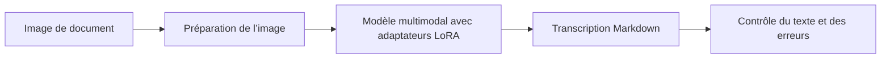
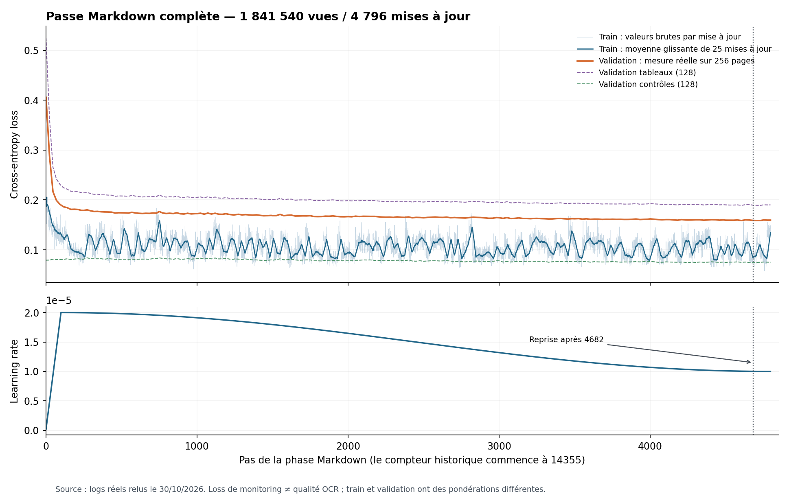

# Fine-tuning d’un modèle OCR multilingue

## 1. Ce que nous cherchons à construire

Nous voulons transformer une image de document en une transcription structurée en **Markdown**, en conservant le contenu visible : texte, titres, listes et tableaux. Les langues visées sont **l’arabe, le français et l’anglais**.

La qualité recherchée concerne autant la présence du bon texte que sa fidélité : ne pas inventer une phrase, ne pas poursuivre sur un autre sujet après la fin de page, conserver les caractères spéciaux et respecter la forme des chiffres. Par exemple, `١٢٣`, `۱۲۳` et `123` représentent des familles de caractères distinctes que nous souhaitons préserver telles qu’elles apparaissent.



Cette sortie est une génération de texte à partir de l’image. Elle ne garantit pas à elle seule des coordonnées de zones fiables ni une restitution exacte de toute la géométrie d’un tableau.

## 2. Quel modèle entraînons-nous ?

Nous utilisons **Qwen3.5-9B**, un modèle multimodal pouvant recevoir une image et une consigne textuelle, puis générer une réponse. Il s’agit d’un modèle préentraîné d’environ **9 milliards de paramètres**, que nous adaptons à notre tâche de transcription.

Nous ne réentraînons pas tous ses paramètres : nous utilisons **LoRA**. Cette méthode ajoute de petites matrices entraînables au modèle ; les poids de base restent gelés. Cela réduit le nombre de paramètres à modifier et les besoins liés à leurs gradients et à l’optimiseur.

| Élément | Configuration de notre passe principale |
|---|---|
| Modèle de base | `Qwen/Qwen3.5-9B` |
| Adaptation | LoRA personnalisée |
| Rang / alpha LoRA | 16 / 32 |
| Paramètres entraînables | **29 097 984** |
| Poids de base | Gelés, en BF16 |
| Calcul des adaptateurs | FP32 |
| Contexte maximal | **8 192 tokens**, entrée et cible comprises |
| Images | RGB, ratio conservé, grand côté limité à **1 024 pixels** |

La précision BF16 sert à limiter la mémoire du modèle de base ; les adaptateurs de cette expérience sont calculés en FP32. La présence d’une LoRA ne garantit pas une amélioration : elle peut aussi introduire des régressions qu’il faut mesurer.

La révision du modèle est figée pour retrouver les mêmes fichiers. Voir les [détails du modèle et de l’entraînement](docs/encadrant/02-donnees-et-entrainement.md) et les [sources réellement embarquées](experiments/markdown-v3/code/).

## 3. Quelles données utilisons-nous ?

### Corpus de la passe Markdown

La source est le dataset **`OCR-Data/ocr_data`**, dans une révision figée. La passe décrite ici utilise **103 archives originales et leurs 103 variantes `aug1`**, soit 206 archives. Les variantes `aug2` et `aug3` ne sont pas incluses dans cette passe.

| Partition préparée | Nombre de vues acceptées |
|---|---:|
| Entraînement | **1 841 540** |
| Validation | **99 318** |
| Test | **97 432** |
| Total | **2 038 290** |

Ces nombres comptent des **vues de pages**, avec des variantes augmentées ; ils ne représentent pas autant de documents indépendants. Les variantes d’un original héritent de sa partition pour éviter de les répartir entre entraînement et validation/test. Les 660 vues rejetées lors des contrôles historiques restent comptabilisées dans les audits.

### Pourquoi avons-nous retravaillé les cibles ?

Certaines annotations renvoyaient vers des tableaux au lieu d’en inclure directement le contenu. Nous avons préparé une version contenant les **textes complets et les cellules réelles des tableaux**, insérés dans les cibles Markdown.

Les contrôles de conversion vérifient les cellules, les références internes et les empreintes des objets relus après stockage. Une cible trop longue n’est pas tronquée silencieusement : elle bloque la préparation. Le maximum observé dans le corpus préparé est de **3 587 tokens**, sous cette configuration.

Le Markdown conserve le contenu des cellules, mais n’exprime pas toutes les cellules fusionnées. Leur texte est placé à l’ancre et la géométrie des fusions est conservée dans les audits. Il faut donc distinguer **fidélité du texte** et **fidélité de la structure**.

Preuve de préparation : [corpus-completion.json](results/training/markdown-v3/corpus-completion.json).

### Une limite importante : l’équilibre des langues

Notre objectif est multilingue, mais cela ne signifie pas que le corpus principal est équilibré. Un audit de **45 156 exemples sur 5 archives parmi 206** classe 43 968 exemples comme dominés par l’arabe, 1 152 par l’écriture latine et 36 dans une autre catégorie. Cet audit partiel ne distingue pas précisément français et anglais.

Dans cet échantillon, aucun caractère de chiffre arabo-indien n’a été relevé dans les cibles, alors que les chiffres latins sont nombreux. **Cela constitue une piste à examiner pour les confusions de chiffres, pas une preuve de leur cause ni une description exhaustive du corpus.**

Les chiffres de cet audit figurent dans [le diagnostic daté](reports/diagnostic/mesures.json), qui est une photographie antérieure à la fin de l’essai correctif présenté plus bas.

## 4. Comment se déroule l’entraînement ?

### Supervision image → texte

Pour chaque exemple, nous préparons une image, une consigne de transcription et le texte de référence. Le modèle apprend à prédire les tokens de la réponse attendue. Les tokens de la consigne et de l’entrée sont masqués dans la loss ; la cible et sa terminaison sont supervisées.

Pendant l’entraînement, la référence sert à calculer l’erreur. **Pendant les tests de génération, la référence n’est pas fournie au modèle** : il reçoit l’image et la consigne, puis sa sortie est comparée au texte attendu.

### Les étapes à ne pas confondre

| Étape | Initialisation et rôle | État |
|---|---|---|
| Entraînement historique | Première adaptation, jusqu’au checkpoint parent **14355** | Parent conservé |
| Nouvelle passe Markdown | Adaptateurs du parent 14355, mais optimiseur et curseur neufs pour les nouvelles cibles complètes | Terminée au checkpoint **4796** de la phase |
| Évaluation intermédiaire | Génération sur 31 images avec le checkpoint **4707** de cette même phase | Résultats archivés |
| Petit essai correctif | Qwen original + **LoRA neuve**, sans hériter de l’adaptateur précédent | Terminé ; candidat non promu |

Le checkpoint de phase **4796** correspond au compteur historique global **19151**. Ce ne sont pas deux modèles supplémentaires : les compteurs décrivent des niveaux différents de l’historique.

### Paramètres de la passe Markdown

| Paramètre | Valeur réellement enregistrée |
|---|---|
| GPU | **1 NVIDIA H200** |
| Processus GPU | `WORLD_SIZE=1`, avec le code DDP |
| Microbatch | 1 page par micro-étape |
| Accumulation des gradients | 384 micro-étapes |
| Batch global | 384 vues par mise à jour, sauf le dernier lot partiel |
| Couverture | 1 passe sur les 1 841 540 vues d’entraînement |
| Optimiseur | AdamW |
| Learning rate | Warmup de 100 mises à jour jusqu’à `2e-5`, puis décroissance cosine vers `1e-5` |
| Weight decay / gradient clipping | 0,01 / 1,0 |
| Graine principale | 42 |
| Monitoring de validation | 128 pages avec tableaux + 128 pages contrôle |

L’accumulation permet de constituer un batch de 384 exemples tout en ne traitant qu’une page à la fois sur le GPU. **Les 256 pages du monitoring ne représentent pas la totalité des 99 318 vues de validation préparées.**

### Contrôles d’exécution et reprise

Avant le lancement, un contrôle réel vérifie notamment une mise à jour des paramètres, les gradients finis, l’exécution des kernels optimisés et le rechargement exact d’un checkpoint. Le contrôle est ensuite annulé pour ne pas le compter dans la passe.

La passe s’est arrêtée au pas **4682**, sous le seuil de réserve disque. Un dossier manquant a aussi fait échouer son diagnostic d’arrêt. Après extension du stockage et création du dossier, la reprise a restauré le checkpoint, l’optimiseur, les états aléatoires et le curseur, puis continué à **4683**. Les sources participant au hash de configuration sont restées inchangées.

L’entraînement est **terminé depuis le 26 octobre 2026**. Un contrôle indépendant a confirmé la couverture complète et l’égalité du SHA-256 du checkpoint final entre le volume de travail et MinIO.

## 5. Quels résultats avons-nous obtenus ?

### Courbes et pertes de la passe principale

| Mesure | Valeur |
|---|---:|
| Mises à jour réalisées | **4 796 / 4 796** |
| Exemples consommés | **1 841 540 / 1 841 540** |
| Validation au début de la nouvelle passe | **0,406638** |
| Validation finale | **0,159622** |
| Dernière train loss enregistrée | **0,135428** |
| Validation finale — tableaux | **0,190188** |
| Validation finale — contrôles | **0,075116** |

La valeur initiale est celle du **parent déjà adapté**, pas celle du modèle original vierge. La validation globale est pondérée par les tokens supervisés ; la train loss est celle de la mise à jour enregistrée. Leurs niveaux ne se comparent donc pas comme deux mesures identiques.



La figure utilise les **4 796 mises à jour consécutives** et les **202 événements de validation** conservés. Le lissage de la train loss est indiqué dans la légende. Au pas 4707, la validation était de 0,158852 : le dernier checkpoint n’est donc pas automatiquement préférable selon chaque critère.

**La baisse de loss confirme un progrès sur l’objectif supervisé mesuré. Elle ne prouve pas l’absence d’hallucinations en génération libre.**

### Qualité du texte généré

Nous avons évalué notre checkpoint intermédiaire **4707** sur 31 images imprimées publiques : **15 arabes, 8 françaises et 8 anglaises**, avec différentes mises en page. Les images étaient limitées à 1 024 pixels, comme pendant l’entraînement.

| Mesure de notre checkpoint 4707 | Résultat |
|---|---:|
| CER global, pondéré par les caractères de référence | **95,18 %** |
| WER global, pondéré par les mots de référence | **109,96 %** |
| CER médian par image | **23,60 %** |

Ces chiffres incluent les sorties répétitives et les échecs ; ils ne décrivent pas uniquement les meilleurs exemples. Les résultats sont variables selon les documents : certaines transcriptions sont encourageantes, mais les dérives rendent la qualité globale insuffisamment fiable.

Le **CER** mesure les erreurs de caractères et le **WER** les erreurs de mots, en comptant substitutions, suppressions et insertions. Une valeur plus faible est préférable. Un taux supérieur à 100 % est possible lorsque le modèle ajoute beaucoup de texte. Il ne faut pas le convertir en « accuracy » avec `100 − CER`.

Cette évaluation porte sur **4707**, pas sur le checkpoint final **4796** ni sur le candidat correctif. Les annotations publiques ne sont pas toutes retranscrites indépendamment et le recouvrement avec les données préalables du modèle est inconnu. Ce petit jeu exploratoire ne permet pas une conclusion générale sur tous les documents métier.

## 6. Quelles difficultés rencontrons-nous ?

| Problème observé | Manifestation | Ce que nous voulons comprendre |
|---|---|---|
| Hallucinations | Contenu absent de l’image, parfois sans lien avec le document | Fidélité des cibles et dépendance réelle à l’image |
| Mauvaise fin de génération | Ajouts après la transcription, boucles ou répétitions longues | Supervision de fin de réponse, paramètres de génération et arrêt |
| Dérive de langue | Ajout d’arabe après une page française, sans texte arabe visible | Effet du déséquilibre linguistique et de la consigne |
| Caractères spéciaux | Substitutions ou pertes de signes, accents et ligatures | Représentation des glyphes et distribution de ces caractères dans les cibles |
| Forme des chiffres | Conversion entre `١٢٣`, `۱۲۳` et `123` | Fidélité des annotations et couverture des familles de chiffres |
| Mise en page | Omissions, ordre de lecture ou tableaux imparfaits | Résolution, qualité des annotations et limites de la représentation Markdown |

Des sondes du modèle final ont notamment montré des erreurs sur `œ`, `æ`, `ç`, `É` et `À`. Les causes ne sont pas établies. Nous souhaitons distinguer un problème de données, de préparation des entrées, d’adaptation ou de décodage avant de modifier plusieurs paramètres à la fois.

Une génération peut sembler ne jamais finir, mais nos essais ont des limites de tokens et/ou de temps. **Atteindre une limite est une interruption, pas une transcription complète.** De même, un arrêt EOS peut survenir après un texte erroné.

## 7. Quels contrôles et corrections avons-nous déjà essayés ?

Nous avons contrôlé les images effectivement envoyées au modèle, l’identité des checkpoints et la reproduction de sorties dans un processus neuf. Un essai à 1 120 pixels a révélé un effet de résolution ; les résultats retenus pour le jeu de 31 images utilisent le prétraitement natif à **1 024 pixels**. Des essais avec et sans cache ainsi que des consignes plus littérales ont également été effectués.

Les consignes et contrôles de répétition peuvent limiter certaines dérives, mais ils ne corrigent pas automatiquement une mauvaise reconnaissance. Une phrase plausible n’est pas une preuve qu’elle était présente sur la page.

### Essai correctif indépendant

Nous avons préparé un petit corpus public et des contrôles ciblés, puis entraîné une **LoRA neuve sur le Qwen original**. Ce candidat ne poursuit pas l’adaptateur historique et ne le remplace pas.

| Élément | Essai correctif |
|---|---|
| Corpus total | 375 exemples : 299 pages publiques, 61 contrôles littéraux, 15 contrôles blancs |
| Répartition | 300 entraînement / 75 validation ; 100 / 25 par langue |
| Séparation | Groupes documentaires disjoints ; documents du benchmark historique exclus |
| Entraînement | 2 époques, batch global 16, 38 mises à jour |
| Couverture | 600 exemples consommés, correspondant à 300 pages uniques parcourues deux fois |
| Validation globale | **0,641595 → 0,563570**, soit −12,16 % |
| Générations de contrôle conservées | 21 sorties après les deux époques |
| Décision | **Candidat non promu : erreurs de chiffres et de signes encore présentes** |

La sonde française isolée de signes est transcrite exactement, mais des confusions entre chiffres persans et arabo-indiens persistent. Un contrôle arabe atteint encore la limite de génération. Les pages parfaitement blanches sont filtrées avant génération ; leur réussite ne doit donc pas être attribuée à une reconnaissance du modèle.

Les losses des deux entraînements ne sont pas directement comparables : leurs corpus et protocoles diffèrent. Voir le [bilan correctif](reports/corrective/BILAN.md), ses [mesures](reports/corrective/mesures.json) et les [sorties réelles](results/training/corrective-v1/generations/).

## 8. Sur quels points souhaitons-nous être guidés ?

1. **Données et annotations :** quels contrôles prioritaires pour détecter les cibles qui apprennent des ajouts, des omissions ou une normalisation des chiffres ? Comment équilibrer langues et layouts ?
2. **Apprentissage :** nos choix de LoRA, de learning rate et de durée sont-ils adaptés ? Quelles expériences permettraient d’isoler leur effet sans changer toute la configuration ?
3. **Arrêt de génération :** comment vérifier la supervision des tokens de fin et distinguer une boucle, une transcription longue et une mauvaise reconnaissance ?
4. **Caractères et chiffres :** quel protocole construire pour tester systématiquement les accents, signes, ligatures et familles de chiffres ?
5. **Validation :** quel jeu métier annoter humainement, avec quels critères par langue et par type de document ? Comment mesurer les omissions et les ajouts au-delà du CER/WER ?
6. **Choix du checkpoint :** comment évaluer, sur les mêmes entrées, les points 4707, 4796 et le candidat correctif, puis définir des conditions de validation ?

Nous cherchons à choisir une prochaine expérience **limitée, mesurable et reproductible**. Nous ne considérons pas qu’un entraînement plus long ou une loss plus basse suffira à résoudre tous ces problèmes.

## 9. Où trouver les éléments pour votre analyse ?

| Élément | Accès |
|---|---|
| Code exact de la passe Markdown | [experiments/markdown-v3/code/](experiments/markdown-v3/code/) |
| Paramètres enregistrés | [config.json](results/training/markdown-v3/snapshot-20261020/config.json) |
| Preuve indépendante de fin | [verified-final.json](results/training/markdown-v3/verified-final.json) |
| Mesures de toutes les mises à jour | [losses-complete.csv](results/training/markdown-v3/losses-complete.csv) |
| Évaluations réellement émises | [evaluation-complete.csv](results/training/markdown-v3/evaluation-complete.csv) |
| Logs expurgés, exécution et reprise | [results/logs/](results/logs/) · [inventaire](results/logs/inventory.json) |
| Code et configuration du correctif | [trainer](experiments/corrective-v1/code/train_corrective.py) · [configuration](results/training/corrective-v1/config.json) |
| Résultats et preuve de fin du correctif | [results/training/corrective-v1/](results/training/corrective-v1/) |
| Fonctionnement des contrôles hors ligne | [Guide de reproduction](docs/encadrant/04-reproduire-et-lire-les-logs.md) |
| Sources et conditions de réutilisation | [DATA-NOTICES.md](DATA-NOTICES.md) |

Les documents et états intermédiaires sont datés : un ancien fichier « en cours » ne remplace pas les preuves de fin plus récentes. Les poids, le corpus massif d’entraînement et les accès au cluster restent hors GitHub. Les scripts conservent des chemins et dépendances de leur environnement d’origine ; un simple lancement sur un autre poste ne suffit pas à reproduire l’entraînement.

Pour vérifier les empreintes, la couverture des 4 796 mises à jour et les sources exécutées, sans GPU ni réseau :

```bash
python -B tools/verify_evidence.py
```

Cette vérification demande seulement Python 3.10 ou plus. Elle prouve l’identité des fichiers et la cohérence des éléments archivés, pas la justesse de chaque transcription.

Merci d’avance pour votre temps, vos observations et vos recommandations pour améliorer notre approche.
