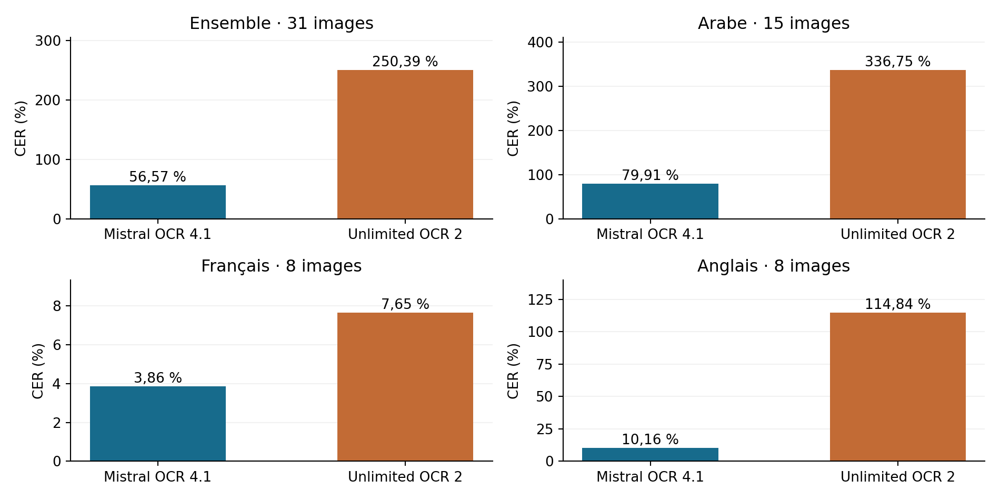
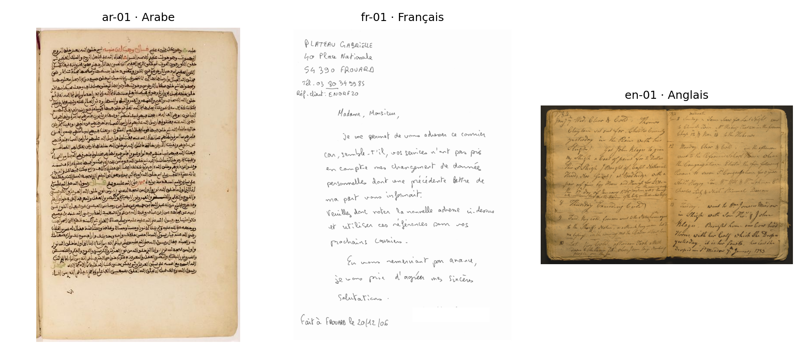

Comparaison OCR sur des pages manuscrites

Mistral OCR 4.1 et Unlimited OCR 2Sovereign Document Suite · 29 octobre 2026 · test exploratoire de 31 images

Résumé des résultats

### Résumé des résultats

Sur ce corpus, Mistral OCR 4.1 obtient les plus faibles taux d’erreur globaux : CER 56,57 % et WER 75,18 %. L’autre modèle obtient respectivement 250,39 % et 340,50 %. Ce classement concerne uniquement les entrées et annotations de ce test.

| Population | n | CER M % | CER U % | WER M % | WER U % |
| --- | --- | --- | --- | --- | --- |
| Ensemble | 31 | 56,57 | 250,39 | 75,18 | 340,50 |
| Arabe | 15 | 79,91 | 336,75 | 98,21 | 429,00 |
| Français | 8 | 3,86 | 7,65 | 14,48 | 21,72 |
| Anglais | 8 | 10,16 | 114,84 | 26,27 | 207,92 |

M = Mistral ; U = Unlimited. Une valeur plus faible est préférable. Le score global est pondéré par les caractères ou mots de référence, pas uniquement par le nombre de pages. Un score supérieur à 100 % est possible en cas de nombreuses insertions.

Figure 1. CER sur les mêmes images. Les panneaux ont des axes différents pour conserver la lisibilité des résultats de chaque langue.

Le corpus arabe rassemble trois manuscrits maghrébins historiques ; l’anglais est également historique, tandis que le français comporte des courriers modernes. Cette étude ne permet pas de conclure sur toutes les écritures manuscrites ni sur un corpus métier inconnu.

---

1 Corpus et protocole

## 1 Corpus et protocole

| Langue | Source et volume | Mises en page |
| --- | --- | --- |
| Arabe | RASAM 1 : 15 pages, 5 de chacun des manuscrits BULAC 1977, 417, 609 | Texte dense ou aéré ; marges ; une à huit zones ; schémas et cases |
| Français | RIMES : 8 lettres modernes, références sans alternatives ambiguës | Expéditeur, destinataire, objet, date, corps et dispositions variables |
| Anglais | Revolutionary City : 8 images historiques | Journaux doubles pages, courriers, adresse sur pli, notes et rotations |

Toutes les images proviennent de documents réellement manuscrits [1–3]. Aucune police imitant l’écriture, aucun montage de lignes et aucun texte généré pour fabriquer le ground truth ne sont utilisés. La sélection est figée avant les appels aux modèles, avec empreintes SHA 256 des images et annotations.

Les transcriptions publiées sont extraites des XML sources : lignes PAGE pour RASAM, blocs textuels RIMES, chaînes ALTO pour Revolutionary City. L’ordre suit les annotations. Les correspondances et mises en page ont été inspectées, sans nouvelle retranscription humaine indépendante de l’ensemble des pages.

1.1 Traitement des zones non transcrites

### 1.1 Traitement des zones non transcrites

Les signatures RIMES n’ont pas de texte de référence dans les boîtes concernées. Ces seules régions sont blanchies dans les images d’inférence, avant les deux modèles et avec les mêmes coordonnées. Les originaux sont conservés. Le test français ne mesure donc pas la lecture des signatures. Une page arabe à importante annotation marginale non transcrite et une page anglaise contenant un segment explicitement illisible ont été exclues avant inférence.

1.2 Entrées et modèles

### 1.2 Entrées et modèles

Les deux services reçoivent exactement les mêmes PNG RGB, limités proportionnellement à 1 024 pixels sur le grand côté avec filtre BICUBIC, sans agrandir les sources plus petites. Cinq sources arabes du manuscrit 1977 ne mesurent qu’environ 724 pixels de hauteur. Aucun ground truth n’est transmis aux modèles. L’unité est une image : certains scans anglais contiennent deux pages physiques. Les petits caractères peuvent donc être très difficiles à lire.

Mistral est appelé sur l’API officielle, identifiant mistral-ocr-4-1 [4]. Unlimited utilise le service déjà déployé et la révision 5632329a32e103d5f1add270681e0f5c1233c6e4, en BF16 [5]. Le budget est inchangé pendant les 31 essais : contexte 8 192, sortie Unlimited au plus 6 000 tokens, température 0. Le mode diagnostique raw conserve les anomalies de structure ; le texte natif décodé est évalué. Ces scores ne mesurent pas le taux d’acceptation des réponses par les garde-fous du mode OCR de production.

---

2 Métriques et lecture des erreurs

## 2 Métriques et lecture des erreurs

Le CER est la distance de Levenshtein entre caractères divisée par la longueur de référence ; le WER applique le même principe aux mots séparés par des espaces [6,7]. Chaque substitution, suppression ou insertion coûte une unité.

CER (%) = 100 × (S caractères + D caractères + I caractères) / N caractères

WER (%) = 100 × (S mots + D mots + I mots) / N mots

Le même nettoyage HTML et Markdown est appliqué aux références et prédictions, puis Unicode NFC et regroupement des espaces. Casse, ponctuation, diacritiques et alphabets des chiffres sont conservés. Le préfixe éditorial anglais ^, employé pour les exposants dans le corpus, est retiré des deux côtés. Les abréviations, graphies historiques et fautes d’orthographe des documents ne sont pas corrigées dans les références.

Le résultat global est une micro moyenne : sommes des distances divisées par les volumes totaux de référence. La macro moyenne donne le même poids à chaque page. Les faibles volumes d’une adresse isolée peuvent produire un CER élevé pour peu de fautes, tandis qu’une page longue pèse davantage dans la micro moyenne.

| Mesure globale | Mistral | Unlimited |
| --- | --- | --- |
| CER micro % | 56,57 | 250,39 |
| CER macro par page % | 39,94 | 360,53 |
| CER médian par page % | 21,45 | 38,50 |
| WER médian par page % | 55,26 | 88,73 |
| Victoires CER sur les mêmes pages | 29 | 2 |
| Victoires WER sur les mêmes pages | 27 | 4 |

2.1 Répétitions et sorties interrompues

### 2.1 Répétitions et sorties interrompues

Unlimited atteint une limite de génération sur 10 page(s). Ces transcriptions partielles sont conservées et évaluées. Mistral ne fournit pas ici de motif EOS comparable : un HTTP 200 n’est pas une preuve de transcription complète. Les réponses et limites observées sont archivées.

Un indicateur recherche six répétitions consécutives ou plus d’un motif de un à huit mots. Il signale 9 sortie(s) Mistral et 10 sortie(s) Unlimited. C’est un repérage à examiner, pas un taux d’hallucinations : une répétition peut être présente dans le document, et une hallucination peut ne pas se répéter.

Une génération trop longue peut dépasser 100 % de CER/WER. Il serait erroné de convertir ces taux en une précision avec la formule 100 − erreur. Les scores ne constituent pas non plus une mesure de qualité géométrique des tableaux ou des zones.

---

3 Exemples et limites de validité

## 3 Exemples et limites de validité

Figure 2. Entrées fixes ar-01, fr-01 et en-01 : manuscrit dense, lettre moderne, journal sur double page. Le tableau HTML contient toutes les images et les deux transcriptions intégrales.

| Page | CER M % | CER U % | WER M % | WER U % |
| --- | --- | --- | --- | --- |
| ar-01 | 88,94 | 466,37 | 97,52 | 683,97 |
| ar-07 | 89,13 | 37,50 | 100,00 | 88,73 |
| fr-01 | 1,55 | 4,26 | 12,05 | 18,07 |
| en-01 | 12,00 | 31,50 | 29,77 | 58,02 |

Les trois images ont été fixées pour illustrer les sources et ne remplacent pas les 31 mesures. La ligne ar-07 ajoute un contre-exemple observé : Unlimited y obtient un CER plus faible que Mistral. L’inspection des sorties arabes Mistral montre des répétitions et des omissions sur plusieurs pages denses, malgré une réponse API valide. Sur ar-01, Unlimited répète également du texte et atteint la limite. Une revue de fidélité reste nécessaire.

3.1 Portée de la comparaison

### 3.1 Portée de la comparaison

Ce petit échantillon n’est pas un tirage représentatif de toutes les écritures. Les quinze images arabes proviennent de seulement trois manuscrits ; les images anglaises distinctes ne prouvent pas l’indépendance des auteurs ou documents. Aucun intervalle de confiance sur une population générale n’est revendiqué. Langue, période, source, densité et résolution sont confondues : la faible définition des cinq scans du manuscrit 1977 empêche d’attribuer leurs erreurs à la seule écriture arabe.

Les annotations publiées ne sont pas exemptes de conventions ou d’incertitudes : variantes orthographiques, mots barrés, ordre de lecture, exposants, zones non transcrites. Les scores mesurent la proximité à ces références. Le chevauchement avec les données d’entraînement est inconnu. Mistral expose un identifiant de version API, sans hash immuable des poids ; la répétabilité future des générations n’est pas garantie.

La comparaison porte sur les services configurés, dont Unlimited est prévu pour des entrées unitaires. Les doubles pages et textes à orientations multiples sont des cas exigeants pour cette configuration. Un découpage préalable en pages ou zones, ou une résolution supérieure, devrait faire l’objet d’un protocole séparé ; aucun résultat de ce type n’est mélangé aux scores présents.

---

Annexe A Mesures sur les 31 images

## Annexe A Mesures sur les 31 images

M = Mistral ; U = Unlimited. Scores en pourcentage ; les valeurs complètes et compteurs sont dans le CSV. « Limite » signale un arrêt Unlimited avant EOS.

| Page | CER M | CER U | WER M | WER U | Arrêt U |
| --- | --- | --- | --- | --- | --- |
| ar-01 | 88,94 | 466,37 | 97,52 | 683,97 | limite |
| ar-02 | 80,77 | 344,63 | 98,59 | 356,89 | limite |
| ar-03 | 89,14 | 317,98 | 99,63 | 219,60 | limite |
| ar-04 | 93,11 | 408,99 | 99,84 | 776,42 | limite |
| ar-05 | 89,25 | 229,90 | 100,00 | 404,06 | limite |
| ar-06 | 21,45 | 116,96 | 76,71 | 113,70 | EOS |
| ar-07 | 89,13 | 37,50 | 100,00 | 88,73 | EOS |
| ar-08 | 22,77 | 104,93 | 71,79 | 100,00 | EOS |
| ar-09 | 18,14 | 49,16 | 55,26 | 94,74 | EOS |
| ar-10 | 23,98 | 41,97 | 78,26 | 104,35 | EOS |
| ar-11 | 89,29 | 457,05 | 100,00 | 258,28 | limite |
| ar-12 | 62,12 | 245,59 | 91,25 | 625,94 | limite |
| ar-13 | 82,87 | 533,74 | 94,25 | 294,57 | limite |
| ar-14 | 83,56 | 562,04 | 96,08 | 659,48 | limite |
| ar-15 | 63,92 | 97,22 | 128,33 | 100,00 | EOS |
| fr-01 | 1,55 | 4,26 | 12,05 | 18,07 | EOS |
| fr-02 | 7,98 | 9,69 | 12,61 | 17,12 | EOS |
| fr-03 | 3,68 | 5,78 | 23,33 | 28,89 | EOS |
| fr-04 | 2,38 | 10,11 | 9,92 | 23,66 | EOS |
| fr-05 | 7,82 | 13,30 | 25,00 | 33,57 | EOS |
| fr-06 | 1,07 | 2,32 | 9,28 | 8,25 | EOS |
| fr-07 | 1,15 | 3,06 | 6,82 | 14,77 | EOS |
| fr-08 | 1,96 | 7,35 | 13,11 | 24,59 | EOS |
| en-01 | 12,00 | 31,50 | 29,77 | 58,02 | EOS |
| en-02 | 39,31 | 26,90 | 53,85 | 30,77 | EOS |
| en-03 | 5,62 | 38,50 | 22,71 | 65,70 | EOS |
| en-04 | 6,49 | 16,82 | 17,79 | 37,02 | EOS |
| en-05 | 3,72 | 10,72 | 11,36 | 26,14 | EOS |
| en-06 | 9,93 | 22,49 | 30,00 | 47,00 | EOS |
| en-07 | 8,25 | 19,02 | 30,77 | 44,76 | EOS |
| en-08 | 126,74 | 6940,70 | 166,67 | 13300,00 | limite |

Les sorties coupées à la limite restent dans les mesures. EOS indique un arrêt du générateur, sans garantir l’exhaustivité ou l’absence d’erreurs. Les métriques absentes ne sont jamais remplacées par un zéro.

---

4 Conclusion et reproductibilité

## 4 Conclusion et reproductibilité

Sur les images et conventions de ce test, Mistral OCR 4.1 est le choix favorisé par les deux erreurs globales. Cette observation doit être nuancée par langue et par type de document. Elle n’établit ni un meilleur modèle universel ni une absence d’hallucinations.

Pour la production, un manuscrit difficile nécessite une revue de fidélité, notamment pour les chiffres, dates, diacritiques et texte ajouté après la fin de la page. Le corpus métier doit disposer de références revues indépendamment avant de fixer des seuils d’acceptation. La disponibilité d’un service local Unlimited constitue un critère distinct de la qualité textuelle mesurée.

| Durée descriptive, médiane/page | Valeur |
| --- | --- |
| Appels Mistral HTTP | 1,79 s |
| Appels Unlimited depuis la VM | 12,81 s |

Les clients et infrastructures diffèrent ; ces durées incluent les échanges de leurs routes respectives et ne constituent pas une mesure du seul temps de calcul, un test de charge ni un coût comparé. Une génération répétitive qui atteint le budget de tokens augmente aussi la durée. Aucun déploiement ou entraînement n’a été modifié pour ce test.

Le dossier joint contient les originaux, entrées exactes, annotations XML, références textuelles, sorties réelles, métriques et code. Recalcul hors ligne : python code/recalculer.py. La clé API est exclue des fichiers. Les références ne sont jamais incluses dans les requêtes aux modèles. Les droits et attributions des sources sont conservés dans les métadonnées.

Sources

### Sources

[1] Vidal Gorène et al. RASAM et annotations PAGE XML. https://github.com/calfa-co/rasam-dataset

[2] Grosicki et al et Mitek Systems. RIMES complete, dépôt officiel ouvert en 2024. https://zenodo.org/records/10812725

[3] Nelson et al et American Philosophical Society. The Revolutionary City Corpus. https://zenodo.org/records/15776323

[4] Mistral AI. OCR Processor et API officielle. https://docs.mistral.ai/studio/document-processing/basic_ocr

[5] Baidu. Unlimited OCR 2, révision 5632329a32e103d5f1add270681e0f5c1233c6e4. https://huggingface.co/baidu/Unlimited-OCR-2

[6] Hugging Face Evaluate. CER. https://huggingface.co/spaces/evaluate-metric/cer/blob/main/README.md

[7] Hugging Face Evaluate. WER. https://huggingface.co/spaces/evaluate-metric/wer/blob/main/README.md

Sources consultées le 29 octobre 2026. RASAM : annotations sous Apache 2.0, images des collections BULAC. RIMES : CC BY NC 4.0 selon la notice officielle jointe. Revolutionary City : CC BY 4.0. Les corpus servent à l’évaluation, sans réentraînement.

Empreinte du jeu figé : 5409a6dc85ad4b744fd54c70d041fb060b475cf1c882d8e246f41919ec02bba3
