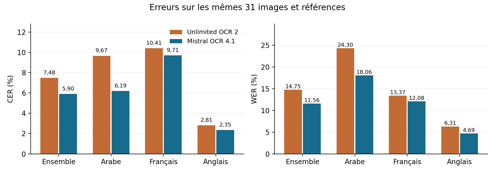
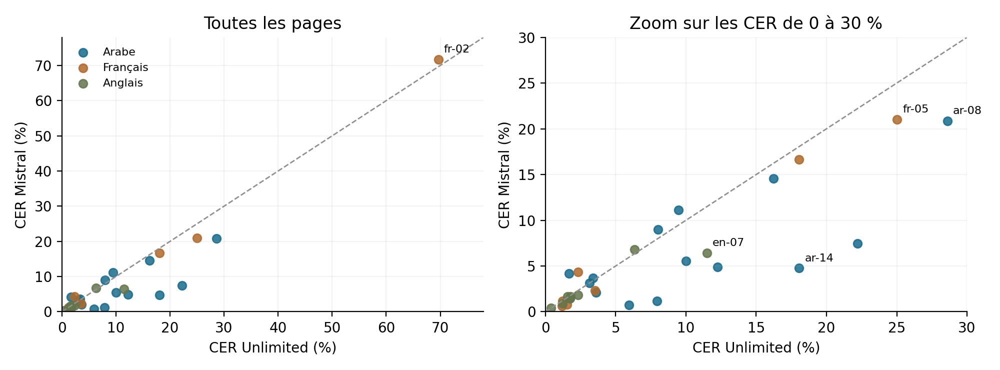
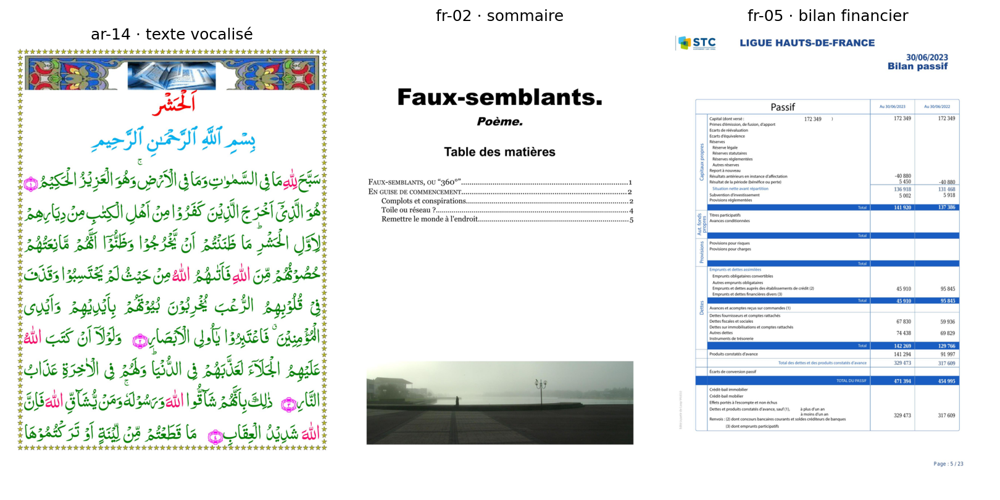

Évaluation comparative de Mistral OCR et Unlimited OCR 2

Rapport expérimental pour Sovereign Document Suite29 octobre 2026 · 31 pages · arabe français anglais

### Résumé

Sur les 31 images de ce test, Mistral OCR présente le plus faible taux d’erreur textuelle global : CER 5,90 % et WER 11,56 %, contre 7,48 % et 14,75 % pour Unlimited OCR 2. La réduction relative des erreurs est de 21,19 % en CER et de 21,57 % en WER.

L’avantage est surtout marqué en arabe. Mistral gagne sur 21 pages en CER ; Unlimited gagne sur 8, avec 2 égalités. Ce résultat concerne un petit jeu de documents publics annotés et ne prouve pas la supériorité sur tous les documents métier. Une anomalie de référence française est explicitée et conservée dans l’analyse principale.

| Population | n | CER Mistral % | CER Unlimited % | WER Mistral % | WER Unlimited % |
| --- | --- | --- | --- | --- | --- |
| Ensemble | 31 | 5,90 | 7,48 | 11,56 | 14,75 |
| Arabe | 15 | 6,19 | 9,67 | 18,06 | 24,30 |
| Français | 8 | 9,71 | 10,41 | 12,08 | 13,37 |
| Anglais | 8 | 2,35 | 2,81 | 4,69 | 6,31 |

Figure 1. Micro moyennes : sommes des erreurs divisées par les volumes de référence. Valeurs faibles préférables.

Décision proposée : privilégier Mistral pour la qualité textuelle observée si l’usage d’une API externe est compatible avec le projet. Conserver Unlimited comme option d’exécution locale sur le cluster. Valider le choix final sur un corpus métier indépendant, avec références corrigées.

---

## 1 Protocole expérimental

### 1.1 Corpus et séparation des références

Le test réutilise les 31 images figées du comparatif antérieur : 15 pages arabes, 8 françaises et 8 anglaises, extraites de NayanaOCRBench Natural [1]. Ces pages représentent 23 documents PDF distincts : 7 arabes, 8 français et 8 anglais. La sélection initiale visait la diversité des mises en page et précédait les nouvelles sorties Mistral.

Les références sont les annotations publiées par le fournisseur. La correspondance image et référence a été inspectée lors de la préparation, sans retranscription humaine indépendante complète. La provenance par scanner physique n’est pas certifiée pour chaque image ; il s’agit d’images de documents réels, non d’un jeu de photographies contrôlé. Le chevauchement avec les données d’entraînement des modèles est inconnu.

Les deux systèmes reçoivent exactement les mêmes PNG RGB, réduits proportionnellement à 1 024 pixels sur le grand côté avec PIL BICUBIC. Les SHA 256 des 31 entrées et références sont vérifiés. Aucun ground truth n’est envoyé à un modèle. Les images pleine résolution sont conservées pour inspection, mais ne constituent pas les entrées de cette expérience.

### 1.2 Modèles et exécution

| Attribut | Mistral OCR | Unlimited OCR 2 |
| --- | --- | --- |
| Exécution | 31 nouveaux appels à l’API officielle | 31 sorties historiques réutilisées, non régénérées |
| Identification | Catalogue API : Mistral OCR 4.1 ; requête et réponse : mistral-ocr-latest | Baidu, révision 5632329a…c6e4 |
| Environnement | POST https://api.mistral.ai/v1/ocr | Inférence native BF16, NVIDIA H200, Torch 2.11.0 |
| Sortie évaluée | pages[0].markdown, tables inline par défaut | Texte après décodage des balises structurelles natives |
| Paramètres | image_url Base64 ; include_image_base64=false ; en-têtes conservés | Contexte 8 192 ; sortie au plus 6 000 tokens ; température 0 |

L’alias Mistral désigne une version susceptible d’évoluer. Le catalogue API et les réponses ont été archivés à la date du test, mais l’API ne fournit pas de hash immuable des poids. Les 31 réponses portent le même identifiant d’alias. Les résultats Unlimited reproduisent exactement les 31 scores du benchmark figé [4].

### 1.3 Paramètres exclus

Aucun entraînement, correction de texte, traduction, enrichissement par un LLM ou sélection de la meilleure de plusieurs générations n’est réalisé. Les 31 appels Mistral ont réussi, avec une page traitée par appel. Les données du déploiement et les sorties antérieures restent conservées.

---

## 2 Définition des métriques

Le CER et le WER utilisent la distance de Levenshtein avec coût unitaire : substitutions S, suppressions D et insertions I [5,6]. Les scores sont exprimés en pourcentage. Ils mesurent des erreurs et ne doivent pas être présentés comme une précision de classification.

CER (%) = 100 × (S caractères + D caractères + I caractères) / N caractères de référence

WER (%) = 100 × (S mots + D mots + I mots) / N mots de référence

Une valeur nulle signifie une égalité après normalisation. Une valeur supérieure à 100 % est possible en présence d’insertions nombreuses. Les mots sont les unités séparées par des espaces ; aucune segmentation morphologique spécifique à l’arabe n’est ajoutée.

### 2.1 Normalisation identique

La même fonction est appliquée au ground truth et aux deux sorties : retrait des commentaires HTML, extraction du texte HTML, retrait des principaux marqueurs Markdown et des liens d’images, normalisation Unicode NFC puis regroupement des espaces. Les cellules sont lues dans l’ordre du texte produit. Les numéros de page, la casse, la ponctuation, les accents, les signes de vocalisation et les alphabets des chiffres sont conservés.

Les caractères numériques arabes et latins ne sont pas convertis les uns vers les autres. Une conversion indue est donc pénalisée. Le nettoyage des marqueurs Markdown peut aussi effacer des caractères littéraux lorsqu’ils ressemblent à du balisage ; il ne remplace pas une évaluation dédiée des symboles. Les sorties brutes restent disponibles.

### 2.2 Agrégation et mesures complémentaires

Le score global principal est une micro moyenne : somme des distances sur les pages, divisée par la somme des longueurs de référence. Une page longue pèse donc davantage qu’une page courte. La macro moyenne donne le même poids à chaque page ; la médiane décrit une page centrale. Les écarts entre ces indicateurs doivent être interprétés, sans choisir après coup celui qui favorise un modèle.

| Indicateur sur 31 pages | Mistral | Unlimited |
| --- | --- | --- |
| CER micro % | 5,90 | 7,48 |
| CER macro % | 7,56 | 9,73 |
| CER médian par page % | 3,67 | 3,60 |
| WER micro % | 11,56 | 14,75 |
| WER macro % | 14,09 | 19,26 |

Mistral obtient la meilleure micro moyenne et macro moyenne CER, mais Unlimited conserve un CER médian légèrement plus faible. Les deux distributions se recouvrent. Le CER/WER ne constitue pas une mesure de structure tabulaire, de localisation des blocs ou un détecteur spécifique d’hallucinations.

---

## 3 Comparaison appariée et incertitude

Les différences sont calculées sur les mêmes pages : Δ = score Mistral − score Unlimited, en points de pourcentage. Une valeur négative favorise Mistral. La réduction relative est un autre indicateur : (score Unlimited − score Mistral) / score Unlimited. Un gain de 1,59 point CER correspond ici à une réduction relative d’environ 21,19 % des erreurs de caractères.

Une analyse exploratoire par bootstrap apparié rééchantillonne les documents PDF entiers au sein de chaque langue, avec remise : 20 000 répétitions, graine 20261029. Les pages d’un même document restent groupées, afin de ne pas supposer leur indépendance [7]. Les intervalles percentiles à 95 % décrivent la sensibilité au rééchantillonnage de ce petit corpus ; ils ne garantissent pas la performance sur une population métier inconnue.

| Population | Δ CER pp | Intervalle 95 % | Δ WER pp | Intervalle 95 % |
| --- | --- | --- | --- | --- |
| Ensemble | -1,59 | [-2,480 ; -0,788] | -3,18 | [-5,001 ; -1,818] |
| Arabe | -3,48 | [-6,645 ; -1,363] | -6,24 | [-11,436 ; -3,046] |
| Français | -0,70 | [-1,779 ; 0,326] | -1,30 | [-3,188 ; 0,187] |
| Anglais | -0,46 | [-1,275 ; -0,005] | -1,61 | [-4,259 ; 0,133] |

L’écart global est négatif pour les deux métriques dans cet exercice de rééchantillonnage. En français, les intervalles recouvrent zéro ; en anglais, celui du WER recouvre zéro et celui du CER s’en approche. Les analyses par langue restent exploratoires, sans correction de multiplicité. Il serait excessif d’affirmer une supériorité établie sur chaque langue.

Figure 2. Sous la diagonale, le CER Mistral est plus faible. Le panneau droit agrandit la zone de 0 à 30 % ; fr-02 reste visible dans le panneau complet.

Comptage page par page : CER, Mistral 21 victoires / Unlimited 8 / égalités 2 ; WER, Mistral 22 / Unlimited 8 / égalité 1. Le classement global n’implique donc pas une victoire systématique sur chaque document.

---

## 4 Inspection des erreurs et des références

Figure 3. Trois entrées réellement utilisées : vocalisation arabe, sommaire et bilan financier. Les textes complets sont consultables dans le tableau HTML joint.

### 4.1 Arabe vocalisé et tableaux

Sur ar-14, le CER passe de 18,05 % avec Unlimited à 4,76 % avec Mistral ; le WER reste toutefois 28,71 %. L’inspection montre davantage d’altérations de mots dans la sortie Unlimited ; Mistral omet encore certains signes. Ce seul exemple ne démontre pas une fidélité parfaite des diacritiques. Sur ar-12, contenant deux tableaux, les CER sont 7,93 % et 1,17 %. Aucun score d’exactitude numérique isolée n’est revendiqué.

### 4.2 Tableaux financiers et ordre de lecture

Pour fr-05, Mistral obtient 21,01 % de CER contre 25,01 % pour Unlimited. Les deux sorties restent éloignées de la référence. Des différences de regroupement des cellules et d’ordre de lecture contribuent au score ; elles ne doivent pas toutes être interprétées comme des mots inventés. Pour un bilan, il faut vérifier les montants et leurs cellules, au-delà d’un score textuel global.

### 4.3 Référence française défectueuse

Sur fr-02, les deux premières entrées du sommaire sont chacune présentes deux fois dans le ground truth, mais une seule fois dans l’image inspectée. Les longueurs des pointillés diffèrent aussi. Une partie des CER très élevés des deux systèmes provient donc de l’annotation et de la représentation des pointillés. La référence n’est pas réécrite après observation des sorties : le tableau principal conserve ce cas, signalé comme anomalie.

Une lecture visuelle ponctuelle complète les mesures mais ne certifie pas toutes les transcriptions. Les insertions, omissions, changements de symboles et divergences d’annotation nécessitent une analyse distincte avant d’être qualifiés d’hallucinations.

---

## 5 Sensibilité et limites de validité

Une analyse secondaire retire uniquement fr-02, pour les deux systèmes et sans réajuster les autres références. Elle sert à rendre visible l’influence d’une anomalie confirmée ; elle ne remplace pas les résultats principaux sur 31 pages et ne constitue pas un nouveau jeu indépendant.

| Population | Modèle | CER % | WER % |
| --- | --- | --- | --- |
| 31 pages originales | Mistral | 5,90 | 11,56 |
| 31 pages originales | Unlimited | 7,48 | 14,75 |
| 30 pages sans fr-02 | Mistral | 5,15 | 11,45 |
| 30 pages sans fr-02 | Unlimited | 6,77 | 14,66 |

Le classement global reste favorable à Mistral dans cette analyse secondaire. Les valeurs absolues de CER changent sensiblement, ce qui souligne l’importance d’une référence exacte avant d’utiliser un score comme critère de recette.

### 5.1 Portée des résultats

Échantillon de convenance : 31 pages ne représentent ni toutes les mises en page ni tous les documents de la Suite. Certaines pages arabes appartiennent au même livre. Aucune puissance statistique ou marge universelle n’est revendiquée.

Références imparfaites : l’erreur de fr-02 est confirmée ; d’autres écarts d’annotation peuvent subsister. Les chiffres mesurent la proximité à ces références publiées, sans prouver une exactitude absolue à l’image.

Résolution contrôlée : Mistral reçoit les mêmes images réduites que le benchmark Unlimited. Les scores ne préjugent pas de la qualité à pleine résolution ou sur des documents PDF natifs.

Comparaison textuelle : l’ordre de lecture et les pointillés peuvent augmenter les distances. Les coordonnées, cellules, tableaux, formules et images ne reçoivent pas ici de score géométrique ou structurel.

Reproductibilité partielle du fournisseur : la version de poids Mistral n’est pas exposée par l’API. Le test peut être réexécuté, mais un alias mis à jour pourra produire des résultats différents.

Généralisation inconnue : absence de preuve d’exclusion des données d’entraînement. Aucun résultat de ce rapport ne démontre une absence complète d’hallucinations.

---

## 6 Choix opérationnel pour la Suite

Si le critère principal est la proximité textuelle aux références sur ce corpus, Mistral est le choix favorisé par les mesures. Si l’exécution dans l’environnement maîtrisé du cluster est prioritaire, Unlimited reste une option cohérente, avec un compromis de qualité mesuré. La décision dépend aussi des contraintes d’intégration, de disponibilité, de confidentialité des documents métier et du coût réel, non mesurés ici.

| Critère | Mistral OCR via API | Unlimited OCR 2 local |
| --- | --- | --- |
| Qualité du test | CER et WER globaux plus faibles | 8 pages gagnées en CER et 8 en WER |
| Lieu d’exécution | Service externe Mistral, image transmise au service | Inférence sur le GPU du cluster |
| Identité du modèle | Alias et catalogue API archivés ; hash des poids indisponible | Révision des poids et code local figés |
| Accès réseau | API officielle accessible depuis le client | Route existante de la Suite ou service interne |
| Coût comparé | Non évalué dans ce rapport | Non évalué dans ce rapport |

### 6.1 Durées observées et comparaison de vitesse

| Mesure descriptive | Valeur | Périmètre |
| --- | --- | --- |
| Mistral, médiane par page | 2,23 s | Aller retour HTTP de 31 appels séquentiels |
| Unlimited, médiane par page | 39,83 s | Chronométrage historique de l’inférence native H200 |

Ces durées proviennent de protocoles différents, à des dates différentes, avec un matériel et une charge inconnus côté Mistral. La réduction de texte produit peut aussi modifier la durée. Elles ne constituent pas un benchmark apparié de vitesse et ne permettent pas de conclure à un facteur d’accélération intrinsèque. Aucun débit sous charge ni coût par document métier n’a été mesuré.

### 6.2 Étape de validation proposée

Constituer un nouveau jeu métier indépendant, annoté et revu par une personne, avant la comparaison. Figer les modèles et mesurer les deux routes dans la même fenêtre de test. Ajouter des contrôles ciblés : montants, dates, chiffres arabes, signes spéciaux, texte après la fin de page et fidélité des cellules de tableaux. Définir les seuils d’acceptation avant de relire les résultats, puis réaliser une revue en aveugle des erreurs critiques.

Le présent travail ajoute une évaluation ; il ne remplace pas le déploiement Unlimited existant et ne modifie aucun entraînement.

---

## Annexe A Résultats sur chaque page

Même référence et même image pour chaque paire. Valeurs en pourcentage ; U = Unlimited, M = Mistral. Le fichier CSV conserve la précision complète et les nombres d’erreurs.

| Page | CER U | CER M | WER U | WER M | Δ CER pp | N car. |
| --- | --- | --- | --- | --- | --- | --- |
| ar-01 | 3,12 | 3,12 | 12,90 | 9,68 | 0,00 | 384 |
| ar-02 | 8,01 | 8,98 | 14,94 | 17,24 | 0,98 | 512 |
| ar-03 | 9,47 | 11,11 | 39,47 | 18,42 | 1,65 | 243 |
| ar-04 | 1,69 | 4,18 | 8,12 | 7,01 | 2,48 | 1652 |
| ar-05 | 10,02 | 5,53 | 15,25 | 9,49 | -4,48 | 1807 |
| ar-06 | 1,74 | 1,51 | 8,60 | 7,85 | -0,23 | 3445 |
| ar-07 | 16,23 | 14,56 | 43,91 | 40,22 | -1,67 | 1497 |
| ar-08 | 28,60 | 20,87 | 63,79 | 57,18 | -7,73 | 2084 |
| ar-09 | 12,24 | 4,90 | 20,16 | 12,90 | -7,34 | 817 |
| ar-10 | 3,39 | 3,67 | 9,83 | 10,57 | 0,28 | 2154 |
| ar-11 | 5,94 | 0,73 | 14,17 | 3,54 | -5,22 | 1514 |
| ar-12 | 7,93 | 1,17 | 26,99 | 7,98 | -6,76 | 858 |
| ar-13 | 3,60 | 2,09 | 14,71 | 4,41 | -1,51 | 1195 |
| ar-14 | 18,05 | 4,76 | 60,40 | 28,71 | -13,29 | 820 |
| ar-15 | 22,22 | 7,44 | 48,28 | 33,33 | -14,78 | 1035 |
| fr-01 | 1,55 | 0,77 | 9,20 | 4,60 | -0,77 | 1033 |
| fr-02* | 69,66 | 71,67 | 40,62 | 43,75 | 2,01 | 646 |
| fr-03 | 1,20 | 1,18 | 8,37 | 7,58 | -0,02 | 4747 |
| fr-04 | 3,54 | 2,34 | 11,91 | 14,47 | -1,20 | 1584 |
| fr-05 | 25,01 | 21,01 | 37,69 | 33,21 | -4,00 | 1775 |
| fr-06 | 2,33 | 4,33 | 6,69 | 8,27 | 2,00 | 1548 |
| fr-07 | 18,04 | 16,66 | 15,07 | 14,40 | -1,38 | 3914 |
| fr-08 | 1,19 | 0,62 | 7,17 | 2,05 | -0,57 | 1932 |
| en-01 | 2,33 | 1,84 | 6,40 | 3,54 | -0,50 | 4027 |
| en-02 | 1,80 | 1,67 | 5,45 | 5,86 | -0,13 | 2280 |
| en-03 | 1,74 | 1,45 | 4,15 | 3,69 | -0,29 | 3794 |
| en-04 | 6,34 | 6,80 | 6,94 | 8,67 | 0,46 | 2383 |
| en-05 | 1,59 | 1,64 | 7,84 | 8,15 | 0,05 | 1826 |
| en-06 | 0,39 | 0,39 | 1,30 | 1,30 | 0,00 | 516 |
| en-07 | 11,49 | 6,44 | 22,83 | 6,52 | -5,05 | 1149 |
| en-08 | 1,23 | 0,91 | 3,98 | 2,06 | -0,31 | 4162 |

* fr-02 : doublons dans la référence confirmés à l’image, scores primaires conservés. Δ négatif favorise Mistral. Les 31 références, images et sorties complètes sont jointes dans tableau-comparatif.html.

---

## Annexe B Reproductibilité et références

Le dossier contient : rapport PDF et Markdown, tableau HTML des 31 images avec ground truth et deux sorties complètes, CSV des 62 lignes de métriques, réponses Mistral brutes, sorties Unlimited figées, images exactes d’inférence et images d’origine. Les fichiers de provenance donnent les SHA 256 des sources et les paramètres observés.

Les métriques peuvent être recalculées sans accès réseau : python code/recalculer.py. Les 31 scores Unlimited sont reproduits exactement. Le calcul de distance a été vérifié sur 500 comparaisons indépendantes avec une programmation dynamique simple, ainsi que sur les accents, la casse, les insertions et les alphabets des chiffres.

Les références servent uniquement au calcul local. La clé API utilisée pour les appels n’est incluse ni dans les scripts, ni dans les résultats, ni dans cette archive. Le document HTML Mistral fourni par l’utilisateur a été lu comme documentation ; son empreinte est enregistrée, sans exécuter ses scripts.

Le dataset est publié sous licence CC BY NC 4.0 [1]. Les images et annotations jointes sont attribuées à Cognitive Lab et à leurs sources d’origine ; leur usage reste soumis à cette licence et aux droits applicables aux documents. Le corpus d’évaluation ne constitue pas un jeu d’entraînement métier.

### Sources

[1] Cognitive Lab. NayanaOCRBench Natural, révision 2684870ad1a0ba271ed56c31e19cb05a6b78c291. https://huggingface.co/datasets/Cognitive-Lab/NayanaOCRBench_Natural

[2] Mistral AI. OCR Processor et exemples image_url. https://docs.mistral.ai/studio/document-processing/basic_ocr

[3] Mistral AI. Référence API POST /v1/ocr. https://docs.mistral.ai/api/endpoint/ocr

[4] Baidu. Unlimited OCR 2, modèle et code officiel, révision 5632329a32e103d5f1add270681e0f5c1233c6e4. https://huggingface.co/baidu/Unlimited-OCR-2/tree/5632329a32e103d5f1add270681e0f5c1233c6e4

[5] Hugging Face Evaluate. Character Error Rate. https://huggingface.co/spaces/evaluate-metric/cer/blob/main/README.md

[6] Hugging Face Evaluate. Word Error Rate. https://huggingface.co/spaces/evaluate-metric/wer/blob/main/README.md

[7] Efron B 1979. Bootstrap Methods Another Look at the Jackknife. Annals of Statistics 7(1), 1–26. https://doi.org/10.1214/aos/1176344552

Documentation consultée le 29 octobre 2026. Les méthodes, mesures et observations propres à cette expérience sont distinguées des capacités annoncées par les éditeurs. Les intervalles sont exploratoires ; aucun test de réception métier n’est déclaré réussi sur la seule base de ce rapport.

Empreinte du fichier source Unlimited : caa422ea3344992c76137eec51c3c5387434a3c40a590103e2dfe925ec91f8f0
